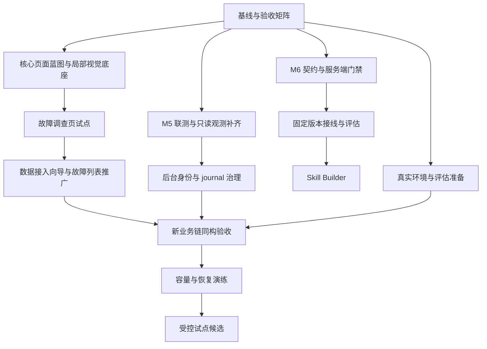

# OpsWeave UI 升级与整体工程推进计划

制订日期：2026-10-15。基线提交：`fad9077`。状态：执行中；本轮交付和实测边界见[执行进展](2026-10-15-execution-progress.md)。

用户范围：同时规划核心 UI 升级和整体研发推进。本文件定义后续工作及验收，不表示任务已实现或检查已通过。

## 1. 目标与版本口径

近期目标：值班人员能沿着「受控数据接入 → Entity/Metric/Incident → 调查任务 → 已保存结果 → 授权证据回读」完成一次可信的只读调查，并在桌面、窄屏和明暗主题下完成关键操作。

整体工程继续沿用 ROADMAP 的 M0–M7 能力阶段。UI 规则中的 0.1.0 是本轮体验规范；ROADMAP 曾建议 M4 对应 0.1.0-alpha、M5–M6 对应后续 beta。本计划覆盖这些能力的推进关系，正式版本号和发布范围在候选验收时单独核对，不将所有后续阶段自动变成 0.1.0 的硬性范围，不创建 Tag。

固定架构边界：Java 21 平台与采集、Rust Runtime、React/TypeScript Web，保留四个启动单元。跨语言契约只维护在 `contracts/`；沿用可信身份、对象授权、共享预算、固定版本/digest、UNKNOWN 和只读工具边界。

## 2. 依据与当前起点

| 依据 | 本计划采用的内容 |
|---|---|
| [架构基线](../architecture/v4-design.md) | 数据所有权、四个启动单元、身份/预算/证据边界；前端实际技术栈以当前兼容性基线和 ADR-059 为准 |
| [整体路线图](../ROADMAP.md) | M0–M7 依赖、首版业务闭环、真实验收与试点退出条件 |
| [实现状态](../IMPLEMENTATION-STATUS.md)、[验证报告](../VALIDATION-REPORT.md) | 以最近补记和 §176–185 判断已实现、实际验证与剩余项 |
| [MVP 清单](../MVP-CHECKLIST.md) | 保留 M0–M4 及 OW-ST01–06 的原退出条件；旧待办需按后续实际证据逐项校正 |
| [ADR-104](../adr/104-durable-ai-run-registry.md) | AIRun、取消/恢复、事件流、Runtime journal 与跨库对账语义 |
| [UI 规范索引](../ui/README.md)、[通用 Rules](../../.agents/rules/README.md) | 页面蓝图、组件/状态/观测规范和真实视觉门禁 |
| [前端规范](frontend-guidelines.md)、[兼容性基线](../FRONTEND-COMPATIBILITY.md) | 现有页面壳层、会话生命周期、React/shadcn 与固定依赖 |

当前事实：

- 接入、模型、工作流、关系维护、发布/采集绑定、留存治理已有大量本地实现与验证，不重新建设这些基础链路。OW-ST01–06 的真实同构、多实例、身份和部署验收仍需分别关闭。
- M5 的 5a–5d 主体已有实现和本地证据。剩余重点是双进程投递联测、对账/观测接入 Web、OIDC 后台委派和 journal 容量治理。
- M6 Skill 发布登记源码、HTTP 入口、内存/PG 存储及 V073 已提交为开发进度；编译通过不等于专项验收，契约、生命周期与发布门禁仍需补齐并实测。
- 历史文档已有本机真实来源和真实模型成功记录；这不能直接证明新注册连接、OW-ST 和 M5 运行路径已通过同构验收。真实 IdP/TLS、人工评估和试点门禁继续保留。
- UI Rules/Skills 已落地，核心页面尚未按新规范完成本轮设计与视觉验收。最近静态基线为 165 文件、0 errors、127 warnings；这是启发式提示，不能折算视觉评分。
- `PROGRESS.md` 的旧百分比以及旧检查点中的“下一步”只作历史参考，不用它们覆盖最近实现记录，也不按测试数量重算完成度。

## 3. 推进顺序与并行关系



UI 试点使用已支持的固定 Skill，可以与 M6 完善并行。Skill Builder 依赖 S1/S2；若将动态 Skill 纳入某次发布候选，还必须通过 S3 的专项门禁。真实环境准备从第一阶段开始，环境就绪后穿插联测。

## 4. 工作包与完成条件

所有工作包初始状态均为待执行。负责人按 Web、Java、Runtime、验证/交付职责分配，可由同一人承担；团队人数和投入未确定，暂不承诺日历日期。

| ID / 优先级 | 前置 | 工作与主要交付物 | 可检查的完成条件 |
|---|---|---|---|
| B0 / P0 | 无 | 建立按能力、源码、契约、最近证据、待验收项组织的矩阵；校正旧清单中的已完成项 | 每项明确“已有实现 / 本机已验 / 当前路径待验 / 外部条件待提供”；不修改原退出标准，不凭文档存在勾选通过 |
| U0 / P0 | B0 | 完成三张核心页面的信息层级、状态表、桌面/窄屏蓝图；对照现有 Token 做局部 `.ow-v2` 映射 | 蓝图能逐字段对应实际 API；新 Token 有双主题定义；现有全局样式、会话和导航行为保持可验证 |
| R1 / P0 | B0 | 完成真实 platform-dev + Runtime journal 的双进程投递/恢复联测；增加观测/对账的严格 Web adapter 与只读展示 | 断连、超时、重复投递、重启、陈旧报告和两侧状态分歧均有实际证据；原运行状态/事件/费用不被对账修改，UNKNOWN 可见，重放零副作用 |
| S1 / P0 | B0 | 补齐 Skill 登记的 ADR、闭合 Schema/样例/OpenAPI、HTTP 错误边界、分页与生命周期回归 | 核查 `SkillRelease.Conflict` 错误映射及版本分页哨兵裁剪；幂等/CAS、跨租户/对象拒绝、作者与发布者分离、不可变版本、失败不移动发布指针有领域/PG/HTTP 证据 |
| U1 / P0 | U0；依赖既有 M5 契约 | 以平台诊断页为试点：摘要、证据、发现/假设、运行状态与结果回读分层；接通受控 AIRun 提交和结果导航 | 不把旧同步诊断标成持久任务；区分请求标识、AIRun 与 AIInsight 引用；刷新/返回只回读，取消/恢复沿用既有语义；通过本文件第 6、7 节门禁 |
| U2a / P1 | U1 | 数据源中心与设置抽屉整理为来源、连接、范围、发现/预览、映射/发布、启用绑定的连续旅程 | 连接通过、已发布、已绑定、已接收数据分别显示；确认/发布/绑定不暗中启动采集；凭据不回显，配置变化使旧检查失效，未知写入保留原请求 |
| U2b / P1 | U1 | 故障列表使用紧凑表格、主次信息和上下文跳转；复用已验证页面模式 | 查询范围、分页和部分性准确；仅使用现有契约字段，当前页数量不冒充全量；进入调查带授权对象上下文，点击详情不自动执行诊断 |
| R2 / P1 | R1 | 设计并实现 OIDC 后台委派接线，以及 journal 配额/压缩/轮转/故障披露 | 撤权、过期、恢复时重授权与旧 worker fencing 有实测；压缩后重放等价、崩溃不丢已确认记录，磁盘不足显式失败；保留 dev loopback 默认边界，不新增数据库 |
| S2 / P1 | S1 | 明确 Skill 停用与在途运行语义；Rust 受信任定义解析和固定版本/digest 接线；只读评估与版本比较 | 旧 AIRun 不随发布指针漂移；停用控制新运行；Schema/路径不触发远程下载；配置不能扩权或绕过共享预算；结构检查与真实模型评估结果分开 |
| S3 / P1 | S2，复用 U1 模式 | 表单式 Skill Builder：草稿、检查、评估/比较、审核发布、停用、回退、版本/运行/费用回读 | 用已有 Rust 模板；旧版本只读；发布失败不污染线上；回退不改历史；身份切换/未知回执/键盘/六组视口主题有专项验收 |
| E0 / P0 并行 | B0 | 准备隔离环境、授权范围、合成与真实数据标记、脱敏评估集、验收脚本和人工评审责任 | 只通过本机配置引用提供来源/模型/IdP/Secret；明确真实对象与预期结果，未具备的条件保留待验，不在报告中放凭据或客户原文 |
| E1 / P1 | 对应 UI/后端包，E0 | 对注册来源、OW-ST01–06、新 M5 诊断路径做同构整链；完成 M0–M4 相关真实退出项 | 同一来源的实体/指标/告警/Incident 可关联并追溯；诊断已保存且证据逐条授权回读；重启/撤权/故障负例、真实 IdP/TLS、费用核对与人工审阅有记录 |
| P1 / P1 | 本地闭环稳定，E1 可分项并行 | 根据实际部署规模确定容量预算，执行积压、慢消费者、多实例 fencing、数据库/来源/模型故障、升级回退和备份恢复演练 | 有环境、输入、资源消耗、阈值和实际结果；验证恢复后的数据、权限和幂等；结果不能仅是 HTTP 200；单节点与 HA 结论分开 |
| P2 / 发布门禁 | 本次候选范围内各包通过 | 汇总版本锁定、迁移、受限运行角色、Secret 配置、留存和运维手册，形成受控试点候选 | 原 M0–M4、选入的 M5/M6 和 UI 门禁逐项核对；遗留问题有范围与责任人；无关键越权、数据误导或主流程不可达问题；正式版本/部署另行执行 |

现有资产/指标/工作流/关系维护在 U2 后按实际使用优先级逐页推广，单独维护迁移清单。共享壳层的大范围变化安排独立变更，并跑全量浏览器回归。

## 5. 第一个执行周期

第一周期完成「可审查的蓝图 + 一个能验收的调查页纵切」，同时收口已提交 Skill HTTP 边界的风险，不批量改造全部页面。

1. B0：整理新旧文档差异与实际 API 清单，输出验收矩阵，标出同步诊断、AIRun 和 AIInsight 的对应关系。
2. U0：以第 6 节为起点完成调查页字段映射和状态矩阵，选择现有组件，审查 `.ow-v2` 与旧变量的局部兼容。
3. S1 第一片：复核 Skill 错误响应和版本分页，先补契约/负例，再修正已确认问题；未完成能力继续按在研管理。
4. U1 第一片：拆清请求容器与展示组件，完成已有结果/证据的层级和原标识回读，再把显式提交接到 AIRun，保留同步兼容路径的独立语义。
5. U1 验收片：执行六组视口/主题与异常状态审查，修复 P0/P1，保存仓库外的脱敏截图和实际检查记录。
6. 回顾：只有试点通过，才抽取确实被第二个场景复用的模式并进入 U2；未通过则继续修正试点。

## 6. 调查页试点蓝图

### 页面目的与用户故事

值班人员从一个已授权 Incident 进入调查，在固定时间窗内查看已有事实、数据缺口、诊断进度和带引用的发现，能回读结果并核查每条证据。

成功证据：操作对应唯一受理任务；运行和结果来源可追溯；缺失/过期/越权明确；返回与刷新可按原标识回读；UI 不把任务成功解释为根因已确认。

### 当前入口与组件落点

- 试点入口：`apps/web-console/src/pages/incidents/CurrentDiagnosisPage.tsx`，`#/incidents/current-diagnose`。
- 当前接口：`src/api/insights.ts` 的同步诊断及结果/证据回读；`src/api/ai-runs.ts` 已有列表/详情/事件/取消/恢复/SSE，现由 `src/pages/agent/AiRunsPage.tsx` 消费。AIRun 创建、5d 对账和观测的前端 typed adapter 尚需补齐，分别纳入 U1/R1。
- 复用：`src/components/PageLayout.tsx` 的 `PageHeader`/`PageBody`、现有 `components/ui/`、`components/runs/` 和 `adapters/chart/LineChart.tsx`；避免按规范中的候选名字再造同功能组件。
- `LineChart` 仅作为绘制基础；新趋势展示需补齐缺失区间分段、单位/窗口/来源/聚合、采样披露及文字或表格替代，不能直接用连续折线连接缺失区间。
- `#/incidents/diagnose` 是显式 Fixture 演示入口，保持其数据标记和独立语义。

### 信息优先级

| 层级 | 内容 | 呈现约束 |
|---|---|---|
| Primary | Incident、当前时间窗/来源模式、运行或结果状态、关键发现及不确定性 | 首屏可识别对象、正在做什么和结论依据；一个最主要动作 |
| Supporting | 授权证据列表/时间线、支持/反证/待检查、缺失警告、事件进度 | 字段来自实际契约；若契约只有 findings/evidenceRefs，不强造反证、概率或精确 Tool 步骤 |
| Advanced | 完整标识、版本/digest、费用细项、原始定位条件、对账详情 | 详情/展开区按需读取；不默认渲染敏感原文、Prompt 或私有推理 |

### 布局草图与滚动所有权

外壳沿用现有导航与工作区。候选尺寸为顶栏 56px、导航 216px（折叠 64px）、正文内边距 24px、证据 Inspector 340px；具体适配由试点审查确定，所有值从 Token 获取。

```text
1440 x 900
[现有导航] [面包屑 / Incident / 状态 / 窗口]      [开始调查或查看报告]
           -------------------------------------------------------
           [证据与已有趋势：约 58%] | [发现/假设与运行：约 42%]
           [来源/单位/缺口/时间线]  | [支持/未知/下一步/事件窗口]
           [选中证据 → 按需打开 340px Inspector]

1024 x 768
[折叠导航] [Incident / 状态 / 主操作]
           [证据 | 调查] [统一窗口与缺口]
           [单主列内容；Inspector 作为抽屉，关闭归还焦点]

390 x 844
[菜单] [Incident 摘要与状态]
[主操作，可换行且可触达]
[概要 | 证据 | 调查]
[当前 Tab 的单列内容]
[证据详情单层抽屉；长表格只在自身横向滚动]
```

主工作区负责纵向滚动；证据长表/日志正文只在明确的局部容器滚动。Tab、主题和尺寸变化不触发重复业务请求；复杂画布不要求手机编辑能力。

### 交互映射

| 意图 | 行为与边界 |
|---|---|
| 从故障列表进入 | 带 Incident 和允许恢复的只读筛选；重新授权，页面打开不自动发起诊断 |
| 开始调查 | 明确提交固定对象/时间窗/Skill 的命令，受理后保留服务器 runId；同请求未知时先回查，不换标识重发 |
| 查看运行/报告 | 只读加载状态、有限事件窗口或已保存结果；PENDING/RUNNING/终态和结果可用性分别显示 |
| 选择发现或图表位置 | 仅关联实际引用与可确认时间位置，不推断因果；没有精确定位数据时保留显式列表跳转 |
| 打开证据 | 明确点击后读取；展示来源、观测/可用/过期时间与缺失；失效或无权限安全失败 |
| 取消/恢复 | 取消请求与最终取消分开；恢复仅适用于服务端允许的未完成运行；终态后的新调查是新提交 |
| 切换对象/离开/返回 | 取消页面订阅和迟到响应；离开不取消服务端运行；身份变化清理私有结果，返回按原对象重授权 |

请求状态、数据模式、完整性、新鲜度和运行状态分别建模。Fixture 可以同时是 loading/error/partial，不能被当成排他的成功状态。

| 状态 | 必须呈现 | 验证重点 |
|---|---|---|
| initial / loading | 开始路径、稳定占位、忙碌与取消反馈 | 不闪现旧身份数据，不重复提交 |
| ready / empty | 实际结果；或明确查询完成且无匹配 | 缺失不补 0，不把无结果变成健康 |
| partial / stale | 缺口、截断、最后查询/失效时间与原因 | 保留不确定性，刷新只做授权查询 |
| error / forbidden | 可操作错误；撤权后清理敏感状态 | 401/403/429/5xx 分开，无自动循环重试 |
| fixture / unknown-write | 显式数据来源；原命令/标识的待确认状态 | 不冒充真实，不隐式重复执行 |

图表只展示已授权、实际可取的指标/时间线；单位、聚合、窗口、时区和采样限制齐备。Trace waterfall、APM P95 或深度日志联动须先有对应契约与来源，不能仅因蓝图示例而虚构。

## 7. 统一质量与发布门禁

### UI

- 每张核心页先有字段映射、布局图、组件边界、状态/交互矩阵，再实施；按 `opsweave-ui-design` → `opsweave-page-build` → `opsweave-visual-audit` 工作，观测图表另用 `opsweave-observability-viz`。
- 实际浏览器覆盖 1440×900、1024×768、390×844 的 light/dark，共六组 READY 截图，并补异常/Fixture/展开/键盘状态。确认主题实际生效，不能只设置浏览器偏好后假定应用已切换。
- 键盘焦点、抽屉关闭归还、标签/错误关联、对比度、低运动偏好、遮挡和滚动均需检查。无未解决 P0/P1 且内部评分至少 85/100，才可通过视觉门禁。
- 截图与原始证据保存在仓库外的本机目录，只记录脱敏结果和实际路径；无法运行写 `visual: NOT_RUN`。静态脚本的 warning、TypeScript 或 build 通过均不能代替视觉审查。

### 工程与业务

- 契约正负例、Java 纯领域、Rust 默认/all-features、TypeScript/build 是每个相关实现切片的基础检查；Java 服务变更补针对性编译、领域/HTTP/PG 验证。
- PG/HTTP 测试使用隔离 schema/tenant 与明确来源模式；缺环境造成的 skipped 或失败如实列出。共享数据库互扰要隔离解决，不放宽业务断言。
- 使用受影响 Playwright 回归；共享壳层、路由或跨页会话生命周期变化执行全量浏览器回归。保存实际命令、结果、来源模式、运行版本及剩余项。
- 真实诊断评估覆盖正常、缺失、冲突、过期、越权、注入、超时、非法输出八类；比较确定性摘要与模型摘要，安排人工审阅与费用核对，不输出未经评估的 RCA 准确率。
- 工具/模型/MCP 保持共享有界预算；只读回放不执行动作或通知；模型成功、任务成功、证据有效和根因确认分别判断。

容量场景沿用 ROADMAP 的建议输入：资产有界分页、大量历史事件、反复挂载卸载、多图表、并发运行和慢消费者。先登记硬件、数据分布、实际负载与目标，再确定预算；建议输入不是容量承诺。journal、受保护元数据、日志/指标、备份留存一并纳入治理。

## 8. 外部依赖与后续范围

当前不阻塞规划的待确认项：团队投入、真实来源/模型/IdP 的可用配置引用、目标部署规模/保留期、人工评审负责人、试点环境和正式发布范围。它们分别在估排期、E0、P1/P2 前补齐；不在聊天或普通日志里索取 Secret。

继续保留后续路线：基于已测瓶颈的深度日志/Trace/RAG、MCP、多 Agent、写入型修复与自动化动作。已有方案中仅预留扩展位的能力不计实现。第一轮不扩大到新微服务、新数据库、任意脚本或通用 Skill DAG。

## 9. 本次规划交付状态

本次只整理文档和读取源码，不修改业务实现，不执行上述工作包。功能测试、数据库/模型调用、浏览器截图和视觉评分均未在本次规划中运行；已有历史检查仍以原验证报告为准。

本次实际完成文档校验：10 个文档链接、8 个实现目标路径及路线图/状态入口有效，`git diff --check` 通过；私有资料边界检查通过，2482 个 commit candidate files。上述功能与视觉门禁是后续执行要求，不作为本次通过声明。
